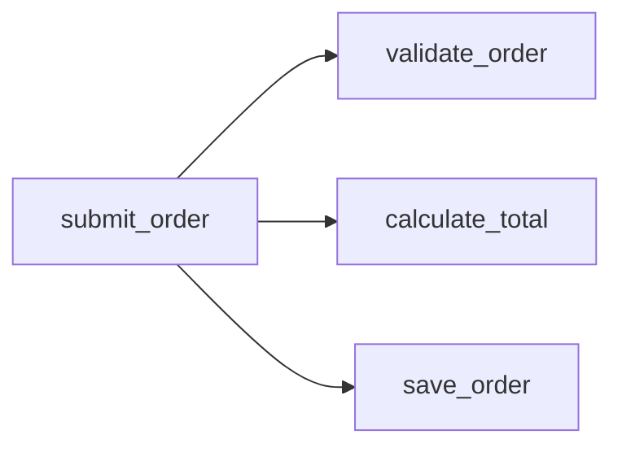

# RepoTrail · 代码路标

给陌生仓库一张地图，给每次输入一条可追踪的路径。

这是项目的第一阶段脚手架：先建立可验证的 Python 仓库结构与图数据接口，再接交互式可视化和输入场景追踪。

## 快速开始

需要 Python 3.10 或更新版本。分析器和开发服务没有第三方运行时依赖，也不需要 API Key。以下命令在项目根目录执行，无需安装：

```bash
python3 run.py --help

# 导出结构化仓库图：模块、类、函数、导入关系与可解析的直接调用。
python3 run.py analyze examples/order_demo -o reports/graph.json

# 导出模块依赖图，文件可在支持 Mermaid 的编辑器中查看。
python3 run.py analyze examples/order_demo --format mermaid -o reports/modules.mmd

# 以一个函数为入口，导出可达的静态调用图。
python3 run.py analyze examples/order_demo --format mermaid --view calls \
  --entry main:submit_order -o reports/order-flow.mmd

# 启动本地只读开发 API。
python3 run.py serve examples/order_demo --port 8765

# 执行测试。
python3 -m unittest discover -s tests -v
```

开发服务入口：`http://127.0.0.1:8765`。当前首页只是 API 开发入口，还不是图形界面。

也可用 `python3 -m pip install -e .` 安装命令，然后运行 `repotrail analyze /path/to/repository`。安装构建工具可能需要联网；`run.py` 路径不需要。

## 目录

```text
RepoTrail/
├── pyproject.toml              包配置、版本、CLI 命令
├── run.py                      无需安装的启动入口
├── src/repotrail/
│   ├── models.py               Node / Edge / Graph 数据契约
│   ├── analyzer.py             AST 索引、导入和直接调用分析
│   ├── exporters.py            JSON 与 Mermaid 导出
│   ├── cli.py                  analyze / serve 子命令
│   └── server.py               本地只读 API
├── examples/order_demo/        订单输入、校验、计价、回执示例
├── tests/                      核心解析与导出测试
└── docs/architecture.md         模块边界与后续扩展
```

## 已实现的基础能力

- 扫描本地 Python 仓库，不导入、不执行目标代码。
- 提取模块、类、同步/异步函数、源码行号及 docstring 首行。
- 连接仓库内部导入，以及能直接解析的函数调用；支持基础相对导入、导入别名和常见 `src/` 布局。
- 导出 JSON、模块依赖 Mermaid 图、按入口过滤的调用 Mermaid 图。
- 为跳过的语法错误文件、过大文件和未解析调用生成提示。
- 提供绑定到 `127.0.0.1` 的只读 API，分析结果为启动时快照。

模块职责文字来自仓库自己的 docstring；暂未接入大模型自动总结。未找到 docstring 时保留空摘要。

## 示例图

以下是示例仓库的静态函数调用关系，表示“入口可能调用这些函数”，不表示输入对象的精确数据血缘，也不表示一次实际执行的先后顺序。



示例程序实际按校验、计价、构建回执的顺序执行。可以独立运行：

```bash
python3 examples/order_demo/main.py
```

## 开发 API

| 路由 | 返回内容 |
| --- | --- |
| `GET /api/health` | 服务状态与版本 |
| `GET /api/graph` | 版本化 JSON 图数据 |
| `GET /api/diagram/modules` | 模块图 Mermaid 源码 |
| `GET /api/diagram/calls` | 调用图 Mermaid 源码 |

节点有 `id / kind / name / file / line / end_line / summary`；边有 `source / target / kind / file / line / evidence`。`file` 相对分析仓库根目录，行号从 1 开始。当前 `evidence` 均为 `static`。

## 当前边界

- 输入为本地目录；GitHub 克隆、浏览器目录导入和多语言解析尚未实现。
- 选择含 `src/` 的仓库时，默认扫描 `src/`；否则扫描整个输入目录。根目录的额外脚本可以单独分析。
- 静态分析是保守的候选关系：不做完整类型推导、控制流分析、名称重绑定分析或跨函数数据流分析。实例方法、继承、多态、装饰器、回调、运行时导入和动态分发可能缺失。
- 函数调用图暂不收集模块顶层调用、装饰器及默认参数求值中的调用。
- 默认跳过虚拟环境、构建产物、隐藏目录和符号链接文件；单文件上限 2 MB，仓库上限 5000 个 Python 文件。
- 导出的图可能包含本地代码名称、路径和文档，适合在本地查看。

## 后续迭代

1. 交互式模块地图：点击模块展开函数，点击节点显示源码证据。
2. 阅读路线：识别应用入口，推荐从入口到核心模块的阅读次序。
3. 输入场景：显式选择入口和 JSON 输入，运行一次并记录实际调用事件、输入输出快照。
4. 区分静态候选边与运行观察边；异步场景进一步区分任务关系与事件顺序。
5. 可选的模块职责总结，保留源码证据和生成来源。

第三阶段会执行目标仓库代码，应作为显式运行操作单独实现；本阶段没有动态执行接口。
