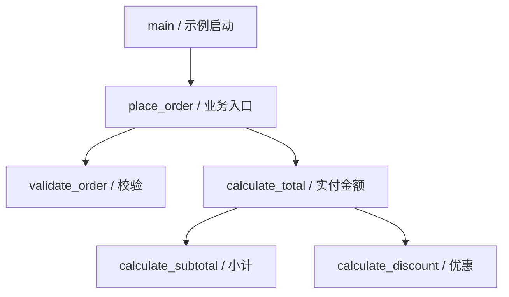

# 订单结算示例

`order_flow.py` 是供后续解析器使用的最小源码样例，只有一个文件、六个函数，没有第三方依赖。

在项目根目录运行：

```bash
python3 examples/order_flow.py
```

## 预期输出

```text
普通订单: {'quantity': 2, 'total_cents': 6000}
满减订单: {'quantity': 2, 'total_cents': 9000}
无效数量: 数量必须大于零
```

金额单位为分。规则是单价、数量都大于零，订单满 100 元减 10 元；示例约定输入都是整数，不额外演示类型校验。

## 预期调用关系



这张图是手工写出的预期调用关系，不是 RepoTrail 自动生成的结果。后续可以用它对照解析结果：应有六个函数，以及图中的五种调用关系。

阅读时从 `place_order()` 开始，再看校验和结算。结算函数内部先求小计，再求优惠。无效订单会在校验时抛出异常，不会执行结算；普通订单与满减订单调用相同的函数，但走优惠计算中的不同分支。

只画静态调用图无法区分这三次实际运行，这也为后续输入场景追踪留下了明确的验证样例。

该示例不涉及数据库、HTTP 服务或真实交易。它是未来解析器的 Python 输入，不属于 RepoTrail 的实现代码；保留它和手工预期关系，用于后续验证解析结果。

项目已确定使用 Python 开发核心功能，旧应用及对应示例测试尚未恢复，目前还不能自动分析本示例。
